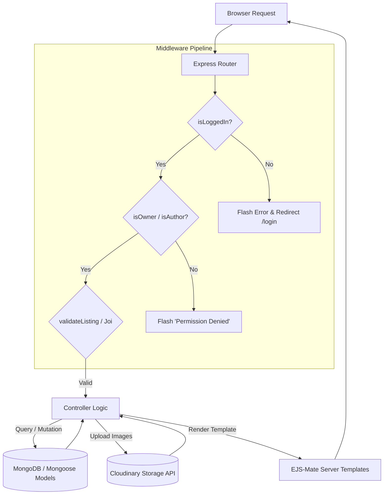
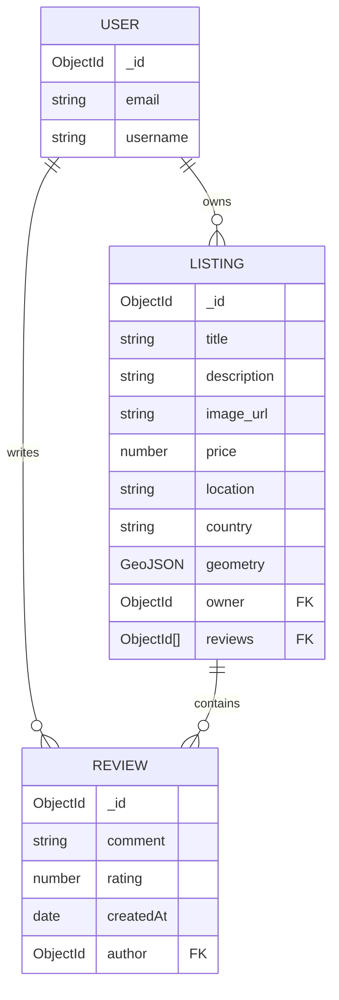

# 🏡 StayBooking — Full-Stack Vacation Rental Platform

A production-ready, full-stack MVC web application inspired by **Airbnb**, enabling users to explore vacation rentals, create custom listings with cloud image uploads, review and rate stays, and view interactive Mapbox location visualizations. Built with **Node.js**, **Express**, **MongoDB Atlas**, **EJS-Mate**, and **Passport.js**.

---

## 📑 Table of Contents
- [Overview](#-overview)
- [Key Features](#-key-features)
- [MVC Architecture & System Flow](#-mvc-architecture--system-flow)
- [Database Schema & Relationships](#-database-schema--relationships)
- [RESTful Routing Matrix](#-restful-routing-matrix)
- [Tech Stack](#-tech-stack)
- [Project Structure](#-project-structure)
- [Getting Started](#-getting-started)
- [Environment Configuration](#-environment-configuration)
- [Engineering Highlights & Interview Talking Points](#-engineering-highlights--interview-talking-points)
- [Author & Contact](#-author--contact)

---

## 🌟 Overview

**StayBooking** demonstrates full-stack software engineering principles following the strict **Model-View-Controller (MVC)** architectural pattern. It implements robust session-based authentication, fine-grained role-based authorization, server-side data validation using Joi schemas, resilient cloud storage via Cloudinary, and geospatial data indexing.

---

## ✨ Key Features

- **🔐 User Authentication & Authorization:**
  - Secure signup and login workflows managed by `passport` and `passport-local-mongoose`.
  - Granular authorization middleware (`isLoggedIn`, `isOwner`, `isReviewAuthor`) guarding protected mutation routes.
- **🏡 Listing Management (CRUD):**
  - Full lifecycle for accommodation listings (title, description, price, location, country).
  - Multer and Cloudinary integration for multipart cloud image uploads.
- **🗺️ Interactive Mapbox Geocoding:**
  - GeoJSON coordinate storage (`Point [lng, lat]`) with interactive Mapbox GL JS rendering and custom popup pins.
- **⭐ Reviews & Star Ratings System:**
  - Authenticated guest reviews with numeric ratings and text feedback.
  - Cascading deletion: deleting a listing automatically cleans up all associated reviews via Mongoose middleware hooks.
- **🛡️ Defensive Validation & Error Handling:**
  - Strict Joi schema validation guarding against malformed payloads.
  - Custom `ExpressError` class and centralized async wrapper (`wrapAsync`).
- **🔍 Location Search Engine:**
  - Real-time search by destination and category filter.

---

## 🏗️ MVC Architecture & System Flow



---

## 🗄️ Database Schema & Relationships



---

## 🔌 RESTful Routing Matrix

| HTTP Method | Route Endpoint | Controller Action | Access Guard | Description |
|---|---|---|---|---|
| `GET` | `/listings` | `listings.index` | Public | List all rental stays |
| `GET` | `/listings/new` | `listings.renderNewForm` | `isLoggedIn` | Render listing creation form |
| `POST` | `/listings` | `listings.createListing` | `isLoggedIn`, `validateListing` | Save listing & upload image |
| `GET` | `/listings/:id` | `listings.showListing` | Public | View listing details & reviews |
| `GET` | `/listings/:id/edit` | `listings.renderEditForm` | `isLoggedIn`, `isOwner` | Render edit form |
| `PUT` | `/listings/:id` | `listings.updateListing` | `isLoggedIn`, `isOwner`, `validateListing` | Update listing details |
| `DELETE` | `/listings/:id` | `listings.destroyListing` | `isLoggedIn`, `isOwner` | Delete listing & cascade reviews |
| `POST` | `/listings/:id/reviews` | `reviews.createReview` | `isLoggedIn` | Submit review for listing |
| `DELETE` | `/listings/:id/reviews/:reviewId` | `reviews.destroyReview` | `isLoggedIn`, `isReviewAuthor` | Delete user review |
| `GET` | `/listings/search/location` | `searchByLocation` | Public | Search listings by location query |

---

## 🛠️ Tech Stack

| Technology | Role | Details |
|---|---|---|
| **Node.js & Express 5** | Backend Runtime & Server | RESTful API and MVC controllers |
| **MongoDB & Mongoose 8** | Database & ODM | Schema validation, GeoJSON indexing, reference population |
| **EJS & EJS-Mate** | Server-Side Templating | Boilerplate layouts, partials, dynamic UI rendering |
| **Passport.js** | Authentication Framework | Local username/password strategy with hashed salt storage |
| **Cloudinary & Multer** | Media Storage & Uploads | Multipart parsing and cloud image transformation |
| **Mapbox GL JS** | Geocoding & Maps | Interactive map pins and coordinate projection |
| **Joi** | Data Validation | Server-side schema integrity checking |
| **Connect-Mongo** | Session Store | Persistent session state survived across server reboots |

---

## 📁 Project Structure

```
StayBooking/
├── controllers/            # Controller business logic (listings, reviews, users)
├── models/                 # Mongoose schema definitions (listing, review, user)
├── routes/                 # Modular Express routers (listing, review, user, search)
├── views/                  # EJS templates and layouts
│   ├── layouts/            # Boilerplate layout shells
│   ├── listings/           # Listing views (index, show, new, edit)
│   ├── users/              # Authentication views (signup, login)
│   └── includes/           # Partials (navbar, footer, flash alerts)
├── utils/                  # ExpressError class and wrapAsync helper
├── init/                   # Database seed scripts and sample data
├── public/                 # Static assets (CSS, client JS, icons)
├── cloudConfig.js          # Cloudinary & Multer storage configuration
├── middleware.js           # Authentication & ownership authorization guards
├── schema.js               # Joi validation schemas
├── app.js                  # Express application setup & middleware stack
├── .env.example            # Environment variable template
└── package.json            # Project dependencies and npm scripts
```

---

## 🚀 Getting Started

### 1. Prerequisites
- **Node.js**: v18.0.0 or higher
- **MongoDB**: Local MongoDB instance or free [MongoDB Atlas Cluster](https://www.mongodb.com/cloud/atlas)
- **Cloudinary Account**: Free tier at [Cloudinary](https://cloudinary.com)
- **Mapbox Account**: Public access token at [Mapbox](https://www.mapbox.com)

### 2. Installation & Setup
```bash
# Clone the repository
git clone https://github.com/aditya-life/StayBooking.git
cd StayBooking

# Install dependencies
npm install

# Setup environment variables
cp .env.example .env
```

### 3. Environment Configuration
Edit your `.env` file:
```env
ATLASDB_URL=mongodb+srv://<username>:<password>@cluster0.mongodb.net/StayBooking?retryWrites=true&w=majority
SECRET=your_super_secret_session_key
CLOUD_NAME=your_cloudinary_name
CLOUD_API_KEY=your_cloudinary_api_key
CLOUD_API_SECRET=your_cloudinary_api_secret
MAP_TOKEN=your_mapbox_token
PORT=8080
```

### 4. Seed Database (Optional)
```bash
node init/index.js
```

### 5. Run Server
```bash
# Production mode
npm start

# Development mode (with live reload)
npm run dev
```

Visit `http://localhost:8080/listings` in your browser.

---

## 🎯 Engineering Highlights & Interview Talking Points

When presenting this project in a backend or full-stack interview:

1. **Defensive Route Ordering in Express:**
   - *Explanation:* Router mount order is strictly sequential. Mounting `/listings/search` **before** `/listings` prevents the wildcard route `/listings/:id` from treating `"search"` as a MongoDB ObjectId parameter, which would otherwise trigger a `CastError`.
2. **Cascading Deletions via Mongoose Middleware Hooks:**
   - *Explanation:* When a listing is removed via `Listing.findByIdAndDelete(id)`, a Mongoose `post("findOneAndDelete")` middleware hook automatically triggers:
     ```javascript
     listingSchema.post("findOneAndDelete", async (listing) => {
       if (listing) {
         await Review.deleteMany({ _id: { $in: listing.reviews } });
       }
     });
     ```
     This prevents orphaned review documents from cluttering the database.
3. **Session Store Durability:**
   - *Explanation:* Using default memory session storage causes memory leaks in production and drops all user sessions upon server restarts. By pairing `express-session` with `connect-mongo`, session states survive process restarts and can scale horizontally across multiple instances.
4. **Defense-in-Depth Validation (Client + Server):**
   - *Explanation:* Form HTML5 validation can easily be bypassed by API tools like Postman or cURL. We implement server-side validation using **Joi** schemas before data ever reaches the controller or database layer.

---

## 👤 Author & Contact

**Aditya Kumar**
- **GitHub:** [@aditya-life](https://github.com/aditya-life)
- **LinkedIn:** [Aditya Kumar](https://www.linkedin.com/in/aditya-life)
- **Email:** aditya12186@gmail.com
